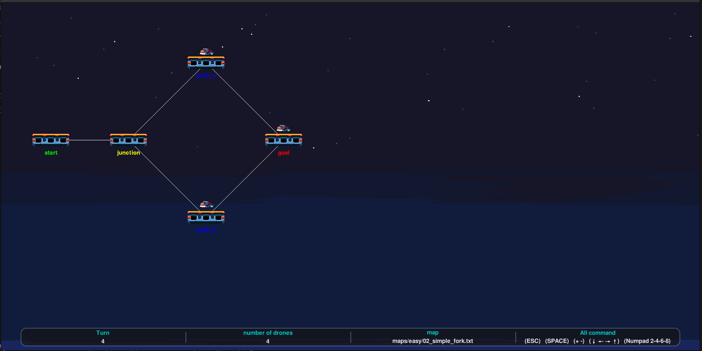

*This project has been created as part of the 42 curriculum by hery-rak.*

# Fly-in


## Description

**Fly-in** is a Python project that simulates a fleet of drones travelling through a network of connected zones.

The goal is to move every drone from a unique starting hub to a unique destination hub in as few simulation turns as possible while respecting:

- zone types and their movement costs;
- zone occupancy limits;
- connection capacities;
- blocked zones;
- simultaneous drone movements;
- restricted zones requiring two turns to reach;
- routing conflicts and congestion.

The project is divided into four main stages:

1. **Parse** the map and validate its structure.
2. **Build** a weighted graph while excluding blocked zones.
3. **Find candidate paths** with Dijkstra and Yen's k-shortest-path algorithm.
4. **Schedule and simulate** all drones while respecting capacities and movement times.

> A graphical representation is also available with **Pygame**, in addition to the colored terminal output.

---

## Features

- Python 3.10+ implementation.
- Fully object-oriented architecture.
- Typed functions and classes.
- Map parser with detailed validation errors.
- Weighted graph representation.
- Dijkstra shortest-path algorithm.
- Yen's k-shortest simple paths algorithm.
- Dynamic route selection for each drone.
- Hub occupancy reservations.
- Connection capacity reservations.
- Support for normal, priority, restricted and blocked zones.
- Two-turn movements for restricted destinations.
- Colored terminal simulation output.
- Pygame graphical visualization.
- Camera panning and zooming.
- Configurable animation speed.
- Makefile for installation, execution, debugging and linting.

---

## Requirements

- Python **3.10 or later**
- Poetry
- A terminal capable of displaying ANSI colors for the colored terminal output
- Pygame for graphical rendering

> The project dependencies are declared in `pyproject.toml`.

Main dependencies include:

- `pygame`
- `python-dotenv`
- `webcolors`
- `flake8`
- `mypy`

---

## Installation

Install the dependencies with Poetry:

```bash
make install
```

This installs the dependencies declared in `pyproject.toml`.

---

## Configuration

The program reads its configuration from a `.env` file or from environment variables.

Create the configuration file from the example:

```bash
cp .env_example .env
```

The available variables are:

| Variable | Required | Description | Default |
|---|---|---|---|
| `MAP` | Yes | Path to the map file | — |
| `RENDER` | No | Enables the Pygame renderer | Terminal output |
| `SPEED` | No | Pygame animation speed | `2` |

Example:

```env
MAP=maps/easy/01_linear_path.txt
RENDER=false
SPEED=2
```

Environment variables can also be provided directly:

```bash
MAP=maps/easy/01_linear_path.txt RENDER=false make run
```

For graphical rendering:

```bash
MAP=maps/easy/01_linear_path.txt RENDER=true SPEED=3 make run
```

`RENDER` accepts `true`, `false`, `True` or `False`.

---

## Usage

### Run the project

```bash
make run
```

The selected map is read from `MAP`.

The program:

1. loads the configuration;
2. parses the map;
3. builds the graph;
4. computes candidate paths;
5. schedules every drone;
6. prints the simulation turn by turn;
7. optionally opens the Pygame renderer.

### Debug mode

The Makefile provides a `pdb` debug target:

```bash
make debug
```

### Code quality

Run the standard linting checks:

```bash
make lint
```

Run the stricter mypy configuration:

```bash
make lint-strict
```

### Cleanup

Remove Python caches and temporary test caches:

```bash
make clean
```

---

## Input Map Format

A map contains the number of drones, one start hub, one end hub, regular hubs and bidirectional connections.

Example:

```text
nb_drones: 4

start_hub: start 0 0 [color=green]
hub: junction 1 0 [color=yellow max_drones=2]
hub: path_a 2 1 [color=blue]
hub: path_b 2 -1 [color=blue]
end_hub: goal 3 0 [color=red]

connection: start-junction [max_link_capacity=2]
connection: junction-path_a
connection: junction-path_b
connection: path_a-goal
connection: path_b-goal
```

### Hubs

A regular hub uses:

```text
hub: <name> <x> <y> [metadata]
```

The special hubs use:

```text
start_hub: <name> <x> <y> [metadata]
end_hub: <name> <x> <y> [metadata]
```

Hub metadata can contain:

- `zone=normal`
- `zone=priority`
- `zone=restricted`
- `zone=blocked`
- `color=<value>`
- `max_drones=<positive integer>`

Metadata is optional.

### Zone types

| Zone | Movement cost | Behaviour |
|---|---:|---|
| `normal` | 1 turn | Standard zone |
| `priority` | 1 turn | Preferred during pathfinding |
| `restricted` | 2 turns | Requires a two-turn movement |
| `blocked` | — | Cannot be entered or crossed |

A blocked zone is excluded from the graph.

A restricted movement occupies the connection during the two-turn traversal and cannot be interrupted by waiting for the destination.

### Connections

Connections are bidirectional:

```text
connection: <hub1>-<hub2> [metadata]
```

Optional metadata:

```text
[max_link_capacity=2]
```

> Zone names cannot contain spaces or `-`, because `-` separates the two endpoints of a connection.

---

## Simulation Rules

The simulation is turn-based.

During a turn, a drone can:

- move to an adjacent hub;
- start or complete a two-turn movement towards a restricted hub;
- remain in place when movement is not possible.

### Zone capacity

By default, a hub can contain one drone.

A custom capacity can be defined with:

```text
[max_drones=2]
```

The start and end hubs have no effective occupancy limit.

When a drone leaves a hub during a turn, its departure frees capacity for another drone entering during the same turn.

### Connection capacity

A connection can limit the number of drones traversing it simultaneously:

```text
connection: A-B [max_link_capacity=2]
```

The scheduler reserves the connection for every turn of a movement and refuses schedules that exceed its capacity.

### Restricted movement

Entering a restricted hub costs two turns.

For example:

```text
A -> restricted_B
```

is represented by:

```text
departure: turn N
in flight: turn N + 1
arrival: turn N + 2
```

The drone cannot wait on the connection during this movement.

---

### Main modules

| Module | Responsibility |
|---|---|
| `main.py` | Application entry point and complete execution flow |
| `parser.py` | Map parsing and validation |
| `parser_models.py` | Network, hub, connection and drone data models |
| `parser_errors.py` | Project-specific parsing and runtime errors |
| `algo_graph.py` | Graph construction, Dijkstra and Yen |
| `simulation.py` | Scheduling, reservations and simulation events |
| `render.py` | Pygame renderer |
| `render_camera.py` | Camera movement and zoom |
| `render_drone.py` | Drone sprite and animation |
| `render_platform.py` | Hub/platform rendering |

---

# Algorithm

## 1. Graph construction

The input network is converted into an adjacency-list graph.

Connections are bidirectional, so each valid connection produces two directed graph edges.

Blocked zones are excluded before pathfinding.

The movement cost is determined by the **destination** zone:

```text
normal     -> 1
priority   -> 1
restricted -> 2
blocked    -> excluded
```

This models the fact that entering a restricted zone requires two simulation turns.

---

## 2. Dijkstra

Dijkstra's algorithm is used to find the minimum-cost path between two hubs.

The graph contains only non-negative edge weights, so Dijkstra is suitable for the weighted routing problem.

A priority queue based on Python's `heapq` module is used to select the next hub with the smallest tentative distance.

The algorithm returns:

```python
(distance, path)
```

Dijkstra is also used internally by Yen's algorithm to find alternative routes.

---

## 3. Yen's k-shortest paths

A single shortest path is not always enough for a multi-drone simulation.

If every drone uses the same shortest route, a low-capacity hub or connection can become a bottleneck.

Yen's algorithm is therefore used to generate multiple simple candidate paths.

The application currently requests up to **20 candidate paths**:

```python
paths = graph.yen(
    network.start_hub.name,
    network.end_hub.name,
    20,
)
```

The first path is the shortest path found by Dijkstra.

For subsequent paths, Yen temporarily ignores selected edges and prefixes in order to find different routes.

This provides the scheduler with several possible routes instead of forcing every drone onto the same path.

---

## 4. Dynamic route selection

Candidate paths are not assigned statically.

For each drone, the scheduler evaluates every available candidate path against the reservations already created by previously scheduled drones.

For each candidate:

1. copy the current hub reservations;
2. copy the current connection reservations;
3. try to schedule the complete route as early as possible;
4. determine its finishing turn;
5. keep the feasible candidate with the earliest finish.

The selected route is then committed to the real simulation state.

This makes route selection depend on the congestion created by drones that have already been scheduled.

---

## 5. Reservation-based scheduling

The scheduler maintains two types of reservations:

### Hub reservations

```python
node_reservations
```

They represent the number of drones occupying a hub at each turn.

### Connection reservations

```python
edge_reservations
```

They represent how many drones are traversing a connection during each turn.

Before accepting a movement, the scheduler checks:

- connection capacity;
- destination hub capacity;
- movement duration;
- current reservations.

If a movement cannot be performed immediately, the drone waits and the scheduler searches for the next valid departure turn.

---

## Complexity

For Yen's algorithm, a simplified worst-case expression for this implementation is:

```text
O(K · V · E log V)
```

where:

- `K` = number of requested candidate paths;
- `V` = number of vertices/hubs;
- `E` = number of graph edges/connections.

The scheduling phase additionally depends on:

- the number of drones;
- the number of candidate paths;
- the maximum simulated turn;
- the number of reservations that must be checked.

The project favours reusable path computation and reservation-based scheduling rather than recomputing the complete graph for every drone.

---

# Visual Representation

The project provides two forms of output.

## Terminal

The terminal displays the simulation turn by turn.

Example:

```text
Turn 1: D1-junction D2-junction
Turn 2: D1-path_a D2-path_b
Turn 3: D1-goal D2-goal

Max turn: 3
```

The destination part of an event is colored according to the hub's configured color when a valid color is available.

## Pygame

The Pygame renderer displays:

- hubs as platforms;
- connections between hubs;
- drones moving along their scheduled routes;
- restricted-zone markers;
- a background;
- camera movement;
- zooming;
- animated drone sprites.

The camera can be moved with:

- Arrow keys;
- Numpad `2`, `4`, `6`, `8`.

Zoom is controlled with the Numpad `+` and `-` keys.

The `SPACE` key pauses or resumes the simulation.

`ESC` closes the renderer.

The renderer uses the assets stored in:

```text
asset/
├── cloud/
├── drone/
└── platform/
```
cloud:<br>


drone:<br>


platform:<br>


---

## Example

### Map

The following example is `maps/easy/02_simple_fork.txt`:

```text
nb_drones: 4

start_hub: start 0 0 [color=green]
hub: junction 1 0 [color=yellow max_drones=2]
hub: path_a 2 1 [color=blue]
hub: path_b 2 -1 [color=blue]
end_hub: goal 3 0 [color=red]

connection: start-junction [max_link_capacity=2]
connection: junction-path_a
connection: junction-path_b
connection: path_a-goal
connection: path_b-goal
```

This map gives the scheduler two possible branches after `junction`.

Because the junction has a capacity of two and the first connection has a capacity of two, several drones can progress simultaneously while the scheduler distributes them between the available paths.

### Running the example

Terminal:

```bash
MAP=maps/easy/02_simple_fork.txt RENDER=false make run
```
screenshot:<br>


Graphical:

```bash
MAP=maps/easy/02_simple_fork.txt RENDER=true make run
```
screenshot:<br>


The repository also contains maps grouped by difficulty:

```text
maps/
├── easy/
├── medium/
├── hard/
└── challenger/
```

---

## Performance

| Difficulty | Objective |
|---|---:|
| Easy | fewer than 5 turns |
| Medium | fewer than 16 turns |
| Hard | fewer than 27 turns |
| Challenger | 43 turns |

---

## Error Handling

The parser validates the input before the simulation starts.

It checks, among other things:

- positive drone count;
- exactly one start hub;
- exactly one end hub;
- unique hub names;
- valid integer coordinates;
- valid zone types;
- positive capacities;
- existing connection endpoints;
- duplicate connections;
- invalid metadata;
- invalid connection syntax.

Parsing errors include the affected line when possible, making invalid map files easier to debug.

Runtime configuration errors are also handled for:

- missing `.env` / `MAP`;
- invalid `RENDER`;
- invalid `SPEED`;
- missing route;
- invalid imports;
- user interruption.

---

## Resources

### Algorithms

- [Edsger W. Dijkstra — shortest-path algorithm](https://www.w3schools.com/dsa/dsa_algo_graphs_dijkstra.php)
- [Jin Y. Yen — k-shortest loopless paths algorithm](https://stackoverflow.com/questions/26054468/yens-k-shortest-algorithm-python-implementation-for-a-10-node-all-connected-g)
- [Python `heapq` documentation — priority queue implementation](https://www.geeksforgeeks.org/python/heap-and-priority-queue-using-heapq-module-in-python/)
- [Scheduling and round-robin scheduling references](https://www.geeksforgeeks.org/operating-systems/round-robin-scheduling-in-operating-system/)

### Rendering

- [Pygame documentation](https://www.pygame.org/docs/)
- [Pygame tutorials and sprite/camera references](https://www.youtube.com/watch?v=8J8wWxbAdFg&list=PLMS9Cy4Enq5KsM7GJ4LHnlBQKTQBV8kaR)

---

## AI Usage

They were used for tasks such as:

- discussing algorithmic approaches;
- reviewing and improving documentation;
- explaining Python concepts and standard-library features;
- identifying possible edge cases;
- helping structure technical documentation;
- reviewing wording and docstrings.

---
