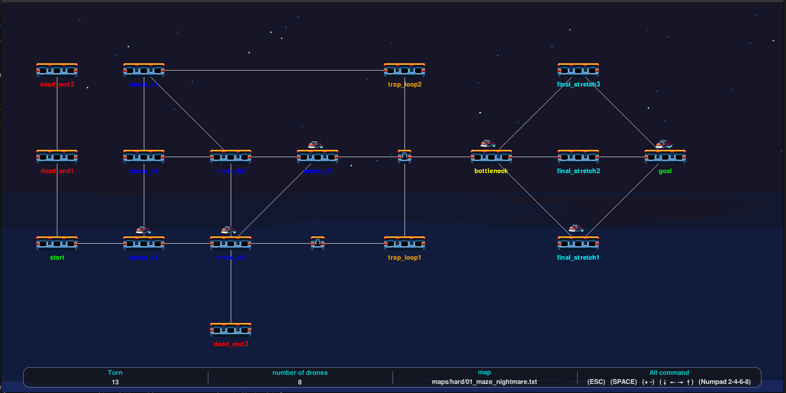
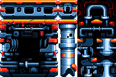
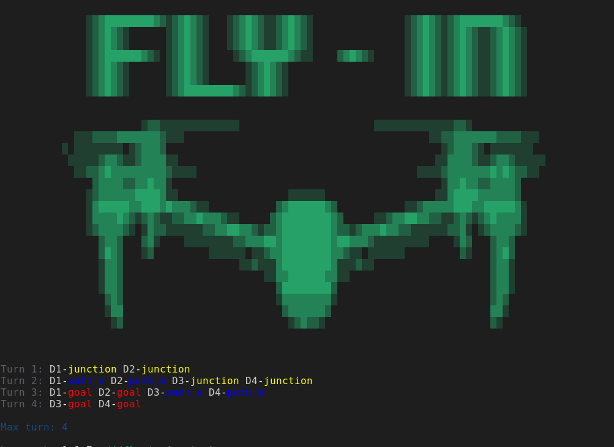

*This project has been created as part of the 42 curriculum by hery-rak.*

# Fly-in

## Description

Fly-in is a drone guidance project developed in Python.

The project aims to manage the movement of multiple drones, verify their integrity, and calculate the shortest paths between a starting point and a destination, taking into account the capacities of each zone as well as the connection capacities between zones. It demonstrates the use of classic weighted graph algorithms, specifically **Dijkstra**'s algorithm (developed by Edsger W. Dijkstra) and **Yen**'s algorithm (developed by Jin Y. Yen).

Data regarding each zone and its connections is defined in a file that is provided to the program.

The project supports both command-line output and a graphical visualization created using Pygame.


## Instructions

### pre-launch
You launch the project using a `.env` configuration file or directly via environment variables;
* For the configuration file, simply copy the `.env_example` file and enter the actual values.
```bash
cp .env_example .env
```
* For environment variables, simply inject the value directly into the command line (see the Makefile section **make run**).
    * MAP: path to your map
    * RENDER: your display preference (boolean) (default: terminal rendering); this option is optional
    * SPEED: animation speed (default: 2); this option is optional

e.g.:
```bash
MAP=maps/easy/01_linear_path.txt RENDER=true SPEED=3
```
> The value of RENDER can be entirely in lowercase.

### Makefile

- Install the project dependencies:

This project uses Poetry for dependency management.

```bash
make install
```

- Executes the main script
```bash
make run MAP=maps/easy/01_linear_path.txt RENDER=false
```

- Run the main script in debug mode using Python's built-in debugger, pdb
```bash
make debug
```

- Delete temporary files or caches to keep the project environment clean.
```bash
make clean
```

- Verify code quality and consistency.
```bash
make lint # or make lint-strict
```

> **make install** just installs or updates the dependencies.

> **make run** launches the program and updates dependencies or installs them completely..


## Resources

- [Dijkstra](https://coddy.tech/visualize/fr/graphs/dijkstras-algorithm)
- [Yen's k-shortest paths algorithm](https://www.linchenguang.com/2018/01/30/Yen-s-algorithm/)
- [Python heap queue documentation](https://docs.python.org/3/library/heapq.html)
- [Pygame documentation](https://www.pygame.org/docs/)
- [Tutoriel Pygame](https://www.youtube.com/watch?v=8J8wWxbAdFg&list=PLMS9Cy4Enq5KsM7GJ4LHnlBQKTQBV8kaR)
- [background pygame](https://gamedevacademy.org/pygame-background-image-tutorial-complete-guide/)
- [Round-robin scheduling](https://en.wikipedia.org/wiki/Round-robin_scheduling)
- [Round Robin geeksforgeeks](https://www.geeksforgeeks.org/operating-systems/round-robin-scheduling-in-operating-system/)
- [Scheduling (computing)](https://en.wikipedia.org/wiki/Scheduling_(computing))

### AI Usage
#################################################


## Algorithm

## Detailed description of the choice of algorithms and the implementation strategy
Arcs are weighted based on the destination zone: standard and priority hubs require one time step, whereas restricted-access hubs require two. Blocked hubs are excluded from the graph. Yen's algorithm generates alternative simple paths. Drones are distributed across these paths and then scheduled using time reservations for each arc traversal and each arrival at an intermediate hub. A restricted movement entails initiating the connection during the first time step and reaching the destination during the second.

- Pathfinding

We used two pathfinding algorithms, Dijkstra and Yen.

<u>**dijkstra:**</u> Dijkstra's algorithm finds the shortest path from a source node to all other nodes in a graph with non-negative edge weights. It maintains a tentative distance for each node, repeatedly selects the unvisited node with the smallest tentative distance, and relaxes its edges-updating a neighbor's distance whenever a shorter route via the current node is found. Press play above to watch the distances decrease as each node is finalized.

Dijkstra's algorithm handles weighted graphs—whether directed or undirected—very well.

The graph includes weights that vary according to the type of destination zone (priority: 0.99; normal: 1; restricted: 2); "blocked" zones are not included in the graph.

- We first have this instruction for the weights.

```python
weight = 1.0
for hub in hub_:
    if node2 == hub.name:
        if hub.zone_type == "restricted":
            weight = 2.0
        if hub.zone_type == "priority":
            weight = 0.99
```
- ...and this instruction regarding the creation of the graph using the `add_summit` function, while ignoring blocked areas.

```python
for connection in network.connections:
    if (network.hubs[connection.hub1].zone_type == "blocked"
            or network.hubs[connection.hub2].zone_type == "blocked"):
        continue
    graph.add_summit(connection.hub1, connection.hub2, hubs)
    graph.add_summit(connection.hub2, connection.hub1, hubs)
```

- Then, we use this graph for pathfinding with Dijkstra

- So, what is the objective of Yen's algorithm? It forms the core of our program. Dijkstra's algorithm simply searches for a single path-which could lead to bottlenecks if certain areas are blocked-so we need to find alternative routes.

Thus, Yen's algorithm generates multiple possible paths (k-paths), ranging from the shortest to the longest.
Here's a brief overview:

```python
prev_path = self.shortest_paths[-1][1]
for i in range(len(prev_path) - 1):
    alternative_summit = prev_path[i]
    accumulate = prev_path[:i + 1]

    sequence_ignore = set()
    for (_, p) in self.shortest_paths:
        if len(p) > i and p[:i + 1] == accumulate:
            sequence_ignore.add((p[i], p[i + 1]))
    ignored_summit = set(accumulate[:-1])

    _, alternative_path = self.dijkstra(alternative_summit,
                                        destination,
                                        ignored_summit,
                                        sequence_ignore)
```

- Next, we move on to the simulations:
Based on a network and either a pre-existing `Graph` object or a set of candidate paths (such as those generated by `Graph.yen`), the system schedules departure and arrival times for each drone while adhering to hub and arc capacity constraints as well as travel time constraints (slower movement in "restricted" zones), and then outputs the resulting events for each time step.

    - Finds the maximum simultaneous capacity of a connection.
    - Returns the number of turns required to reach a given hub.
    - Checks if a leg can be scheduled without exceeding capacity.
    - Reserves link capacity for a leg during its travel turns.
    - Reserves hub occupancy for each intermediate stop on a route.
    - Attempts to schedule a drone's complete journey.
    - Schedules all drones and builds the complete simulation event log.
    - Displays simulation events in the terminal, turn by turn.
    - Colors only the "destination" part of an event according to the corresponding hub's color.
    - Converts a hub color name into a 24-bit ANSI text color escape code.
    - Selects the candidate route that allows an additional drone to finish as early as possible.

Here is a brief overview of the candidate selection process
```python
for index, path in enumerate(paths):
    process = Simulation(self.network, self.graph)
    process.node_reservations = {
        k: dict(value) for k, value in self.node_reservations.items()}

    process.edge_reservations = {
        k: dict(value) for k, value in self.edge_reservations.items()}

    scheduled = process._schedule_path(path, 0, max_steps)
    if scheduled is None:
        continue

    finish = max(scheduled)
    if best is None or finish < best[0]:
        best = (finish, index, process._last_movements, scheduled)

if best is None:
    return None

_, index, movements, scheduled = best

```

## complexity

- Yen's algorithm uses loops to find the K paths
- Outer loop (K): Repeated K times to extract the current shortest path from the candidate list.
- Inner loop (V) (Deviation nodes): For the last validated path, Yen examines each node along that path (up to V nodes in the worst case).
- Call to Dijkstra: For each deviation node, a full Dijkstra's algorithm is executed on the temporarily modified graph.

> Multiplying these factors leads to the following result: `O(K·V·E log V)`.


## Visual Representation

- The Pygame module is used for the visualization component



- Regarding visualization, several features have been implemented to enhance the user experience, such as:
    - the ability to zoom in and out,
    - as well as move the camera to the left or right

These functions are managed by the `Camera` class.

A quick look:
```python
# Get the state of all keyboard buttons (returns a list of booleans)
key = pygame.key.get_pressed()

# Move left if either the Left Arrow key or Numpad 4 is pressed
if key[pygame.K_LEFT] or key[pygame.K_KP4]:
    self.x -= self.speed

# Move right if either the Right Arrow key or Numpad 6 is pressed
if key[pygame.K_RIGHT] or key[pygame.K_KP6]:
    self.x += self.speed

# Move up if either the Up Arrow key or Numpad 8 is pressed
if key[pygame.K_UP] or key[pygame.K_KP8]:
    self.y -= self.speed

# Move down if either the Down Arrow key or Numpad 2 is pressed
if key[pygame.K_DOWN] or key[pygame.K_KP2]:
    self.y += self.speed
```

- The choice of background; the selection of assets for the hubs and drones; the small details indicated at the bottom; and the colors chosen (excluding the hub names) to ensure visual comfort

## Here are the assets used.

<u>for the drone</u>:


<u>for the platforms</u>:



<u>for the background</u>:


## Example input and expected output demonstrating the program’s functionality
## Map
- Map name: 02_simple_fork.txt
- in the folder: maps/easy
- Map content: [content](maps/easy/02_simple_fork.txt)
```bash
# Easy Level 2: Simple fork with two paths
nb_drones: 4

start_hub: start 0 0 [color=green]
hub: junction 1 0 [color=yellow max_drones=2]
hub: path_a 2 1 [color=blue]
hub: path_b 2 -1 [color=blue]
end_hub: goal 3 0 [color=red]

connection: start-junction [max_link_capacity=2]
connection: junction-path_a
connection: junction-path_b
connection: path_a-goal
connection: path_b-goal
```

## Result:
With rendering using Pygame:


With the terminal:


